<p align="center">
  
</p>

<p align="center">
  
  
  
  <a href="LICENSE"></a>
</p>

<p align="center">
  
  
  
  
  
  
  
  
  
</p>

<p align="center">
  <a href="#-what-it-does">What it does</a> ·
  <a href="#-screening-pipeline">Pipeline</a> ·
  <a href="#-screenshots">Screenshots</a> ·
  <a href="#-the-model">Model</a> ·
  <a href="#-results">Results</a> ·
  <a href="#-classification-reports">Reports</a> ·
  <a href="#-quick-start">Quick start</a> ·
  <a href="#-api">API</a>
</p>

<p align="center"></p>

## ✨ What it does

HypeVault is a marketplace for luxury-watch listings with an AI-photo gate in front of it. When a seller uploads a photo, HypeVault decides whether it is a **real photograph of a watch** or an **AI-generated image**, and tells the seller why.

<table>
  <tr>
    <td width="33%" valign="top">
      <h3>🛡️ Screen</h3>
      Every listing photo passes seven checks. The live model is a <b>DINOv3 + Perception Encoder</b> hybrid. Every message starts with its own verdict, for example <i>"rates this photo 100% likely AI-generated"</i>.
    </td>
    <td width="33%" valign="top">
      <h3>⏸️ Hold</h3>
      Edited, cropped or screenshotted AI images are caught by a copy check. Borderline photos are <b>held</b> until the seller sends a proof photo with today's date, and an admin approves it.
    </td>
    <td width="33%" valign="top">
      <h3>📈 Price</h3>
      The watch is identified from the photo or its name. Prices come from live <b>eBay</b> listings (Browse API) and an imported, dated <b>Chrono24</b> dataset, with source and date on every figure.
    </td>
  </tr>
</table>

> [!IMPORTANT]
> HypeVault screens the **photo**, not the watch. A listed watch is not certified authentic. The model covers five brands only: **A. Lange & Söhne, Audemars Piguet, Patek Philippe, Richard Mille and Vacheron Constantin**. Any other brand returns `UNSUPPORTED_SCOPE` with no verdict. It is a research prototype (`AUTHENTICITY_MODEL_PRODUCTION_APPROVED = false`).

<p align="center">
  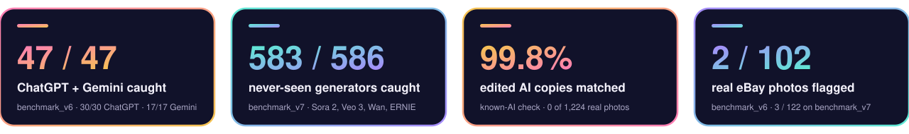
</p>

<p align="center"></p>

## 🔬 Screening pipeline

<p align="center">
  
</p>

| # | Check | What it does | Outcome |
|:-:|---|---|---|
| 1 | 📏 **Size** | The short side must be at least 400 px | Too small → not listed |
| 2 | 🏷️ **AI label** | Reads a signed C2PA *Content Credentials* label (ChatGPT, Gemini) | AI label → not listed, as evidence beside the model's verdict |
| 3 | 🧬 **Known AI copy** | [SSCD](https://github.com/facebookresearch/sscd-copy-detection) copy detection against 2,382 known AI watch images plus every upload rejected as AI. Cosine similarity ≥ 0.65 is a copy | Copy → not listed, as evidence |
| 4 | ⌚ **Is it a watch?** | Zero-shot CLIP | Not a watch → not listed |
| 5 | 🧠 **DINOv3 + PE** | Phase 76 hybrid: P(AI) = σ(score − t<sub>fake</sub>) | AI → **not listed** |
| 6 | ✂️ **Edited copy** | Phase 78 head, trained on screenshot-style copies, or a borderline score (P(AI) ≥ 20%) | Unsure → **held for a proof photo** |
| 7 | 🧑‍⚖️ **Admin review** | The admin compares the first photo with a proof photo (watch + handwritten date + name) | Approve → listed · reject → not listed |

The model always runs, even when the label or the copy check has already decided. The seller first sees what the model decided, then the evidence.

<p align="center"></p>

## 📸 Screenshots

<table>
  <tr>
    <td width="50%">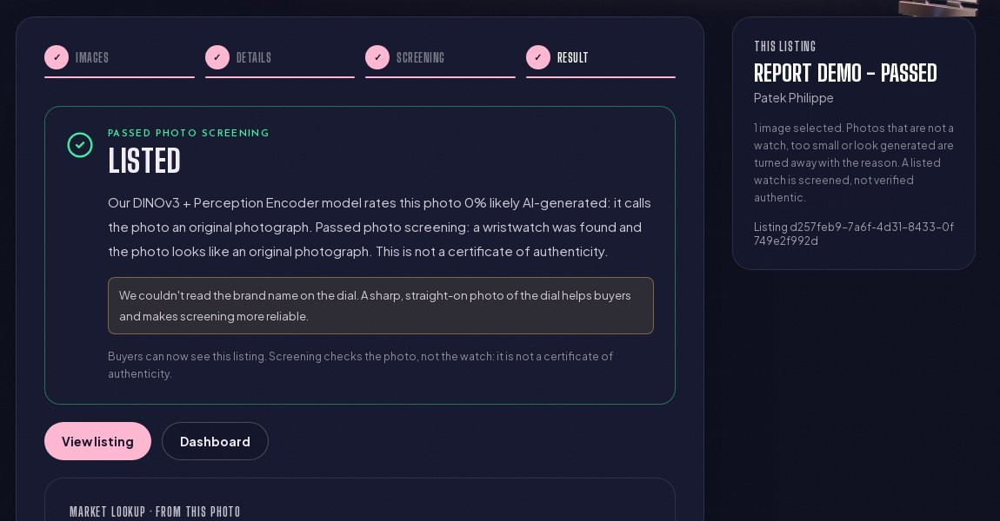</td>
    <td width="50%">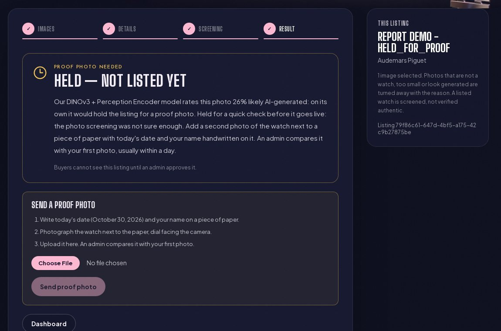</td>
  </tr>
  <tr>
    <td>🟢 <b>Passed.</b> A real photo: the hybrid rates it 0% likely AI and the watch goes live.</td>
    <td>🟡 <b>Held for proof.</b> A borderline score (26%): the seller is asked for a photo of the watch next to today's date and their name.</td>
  </tr>
  <tr>
    <td>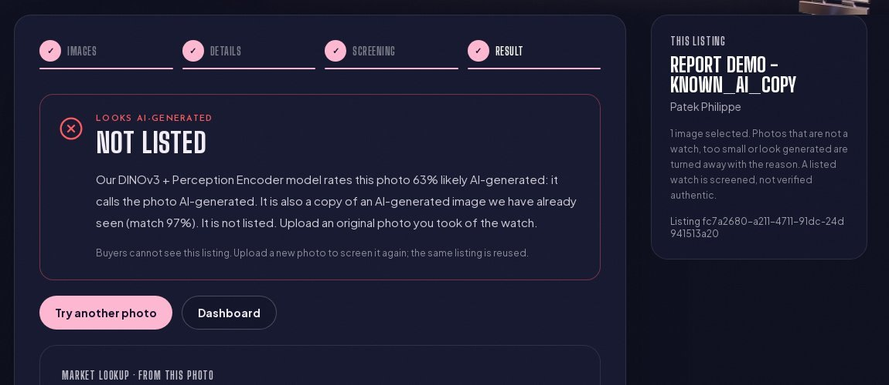</td>
    <td></td>
  </tr>
  <tr>
    <td>🔴 <b>Known AI copy.</b> An edited copy of an AI image already seen (match 97%).</td>
    <td>🔴 <b>AI label.</b> The model says 100% AI first. The signed OpenAI Content Credentials label agrees.</td>
  </tr>
  <tr>
    <td colspan="2">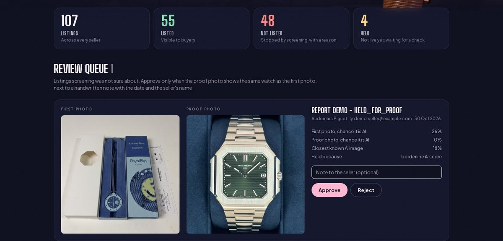</td>
  </tr>
  <tr>
    <td colspan="2">🧑‍⚖️ <b>Admin review queue.</b> The first photo next to the proof photo, with each one's AI chance, the closest known AI image and why the listing was held.</td>
  </tr>
  <tr>
    <td colspan="2">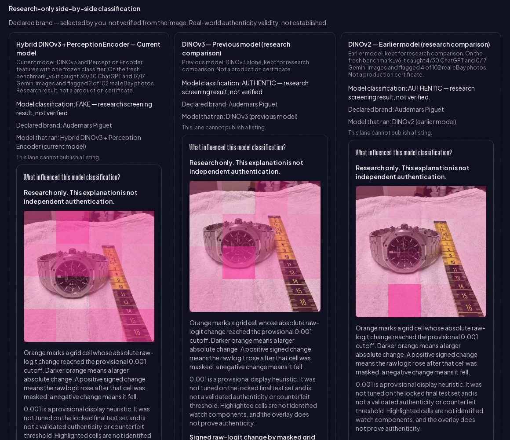</td>
  </tr>
  <tr>
    <td colspan="2">🔬 <b>Research tab: compare all three.</b> On the same Gemini image, the hybrid says <b>FAKE</b> while DINOv3 and DINOv2 alone say authentic. Masked-patch maps show which parts of the image moved each score.</td>
  </tr>
  <tr>
    <td></td>
    <td></td>
  </tr>
  <tr>
    <td>🏠 <b>Home.</b> The five houses HypeVault covers.</td>
    <td>💹 <b>Market.</b> Median asking price and spread from the dated Chrono24 dataset and live eBay listings.</td>
  </tr>
</table>

<p align="center"></p>

## 🧠 The model

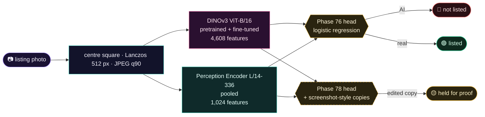

| | Phase 76 (rejects) | Phase 78 (holds only) |
|---|---|---|
| Features | DINOv3 ViT-B/16 (pretrained + fine-tuned `epoch_018`) and Perception Encoder `vit_pe_core_large_patch14_336.fb` | same |
| Head | StandardScaler + logistic regression (C = 0.05, balanced) | same, with 2 screenshot-style copies of every training image |
| Training | 8,314 real photos (Label_0, eBay v1–v5, COCO) · 5,429 generated (benchmarks v1–v4, Kandinsky, frontier generators) · 150 ChatGPT v5 + Gemini v5 images, each ×10 | Phase 76 set + its edited copies |
| Cut | t<sub>fake</sub> = −2.185, set on real photos only (≤ 1% FAKE) | t<sub>fake</sub> = −3.047 |
| Serving | in-process on the RTX 5080 (CUDA) | in-process, same features |

<p align="center"></p>

## 📊 Results

Every benchmark has a protocol written **before** its images existed, a rule frozen on earlier data, and **one** scoring run.

### benchmark_v6 — Phase 76 goes live

<p align="center">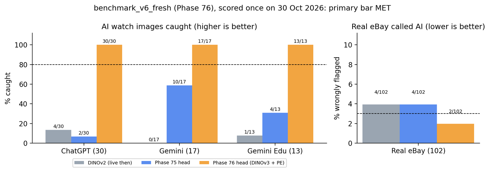</p>

| Group | DINOv2 (live then) | Phase 75 | **Phase 76** |
|---|:-:|:-:|:-:|
| ChatGPT (30) | 4 / 30 | 2 / 30 | **30 / 30** ✅ |
| Gemini (17) | 0 / 17 | 10 / 17 | **17 / 17** ✅ |
| Gemini, second account (13) | 1 / 13 | 4 / 13 | **13 / 13** ✅ |
| Real eBay wrongly flagged (102) | 4 / 102 | 4 / 102 | **2 / 102** ✅ |

The pass bar was met. ChatGPT and Gemini were in Phase 76's training data, so this is a seen-app result.

### benchmark_v7 — never-seen generators (Phase 77 vs Phase 76)

<p align="center">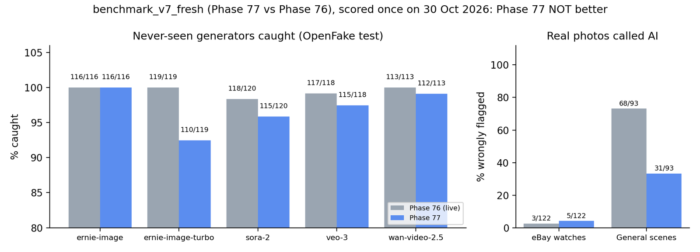</p>

| Group | **Phase 76 (live)** | Phase 77 |
|---|:-:|:-:|
| Never-seen generators: ERNIE, ERNIE Turbo, Sora 2, Veo 3, Wan 2.5 | **583 / 586** | 568 / 586 |
| Anime SDXL (Illustrious) | 56 / 56 | 56 / 56 |
| Real eBay watches wrongly flagged | **3 / 122** | 5 / 122 |
| AUC, never-seen vs real eBay | **0.9996** | 0.9958 |

Phase 77 was **not better**, so it was not merged. Phase 76 stays live.

### Phase 78 — screenshots and crops · known-AI copy check

<p align="center">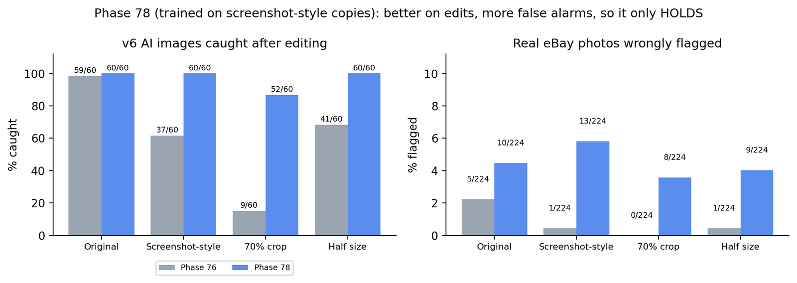</p>

| benchmark_v6 AI images, edited | Phase 76 | Phase 78 |
|---|:-:|:-:|
| Original | 59 / 60 | 60 / 60 |
| Screenshot-style | 37 / 60 | **60 / 60** |
| 70% crop | 9 / 60 | **52 / 60** |
| Half size | 41 / 60 | **60 / 60** |
| Real eBay wrongly flagged (original) | **5 / 224** | 10 / 224 |

Phase 78 catches edited copies far better, but it flags twice as many real photos. So it **only holds** a listing for a proof photo, and never rejects one.

<p align="center">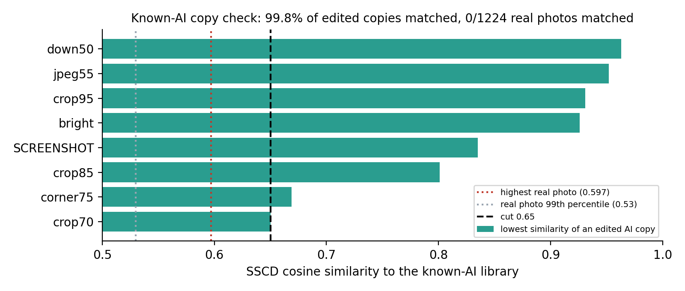</p>

At the 0.65 cut, the SSCD copy check matched **99.8%** of edited AI copies and **0 of 1,224** real watch photos. The highest real photo scored 0.597.

<details>
<summary><b>📜 Full benchmark history (v1–v7)</b></summary>

| Benchmark | Question | Result |
|---|---|---|
| v1: 300 eBay, 284 Kandinsky 2.2, 150 SDXL | DINOv2 or DINOv3? | Underpowered (16 discordant, p = 0.21); DINOv2 stayed live |
| v2: 300 eBay, 287 Kandinsky 2.2, 293 aMUSEd | Watch forensics v1 vs DINOv3 | 63.4% vs 24.1% caught, but 3.7% of real photos rejected. **Not met** |
| v3: 300 eBay, 296 Stable Cascade, 281 Kandinsky 2.2 | Watch forensics v2 vs DINOv3 | Stable Cascade 91.9% vs 68.9% (p = 2.3 × 10⁻¹⁰); real 2.0% vs 0.3%. **Met** |
| v4: 270 eBay, 283 Kandinsky 2.2, 297 Stable Cascade | Phase 74 Kandinsky head | Kandinsky 283/283, Stable Cascade 297/297, real 2/270. **Met** (both generators seen in training) |
| v5: 144 eBay, 75 ChatGPT, 75 Gemini | Phase 75 frontier head | ChatGPT 12%, Gemini 36%. **Not met** |
| v6: 102 eBay, 30 ChatGPT, 17 + 13 Gemini | Phase 76 DINOv3 + PE | 30/30, 17/17, 13/13; real 2/102. **Met** → live |
| v7: 122 eBay, 586 never-seen, 56 anime, 406 seen-family | Phase 77 vs Phase 76 | Phase 77 not better (568 vs 583). **Phase 76 stays** |

<p align="center"></p>

Details live next to each benchmark: `ml_rtx5080/benchmark_v*_fresh/protocol.json` and `report.md`.

</details>

<p align="center"></p>

## 🧾 Classification reports

### Locked final test: fine-tuned DINOv3 (3,006 images, opened once)

<p align="center">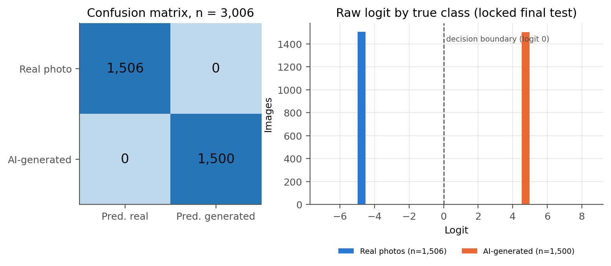</p>

| | Predicted real | Predicted AI | Precision | Recall | F1 |
|---|:-:|:-:|:-:|:-:|:-:|
| **Real photo** (1,506) | 1,506 | 0 | 1.000 | 1.000 | 1.000 |
| **AI-generated** (1,500) | 0 | 1,500 | 1.000 | 1.000 | 1.000 |

ROC-AUC 1.0 and PR-AUC 1.0. False-authentic is 0 / 1,500 (95% upper bound 0.26%). The test images come from the same sources as training, so this shows in-distribution separation only. The fresh benchmarks above test new data.

### Training: four RTX 5080 configurations, 30 epochs, BF16

<p align="center"></p>

The selection rule was written before the test set was opened. It picked **DINOv3 ViT-B/16 + CLS + patch attention, epoch 18** (temperature 0.2404).

<details>
<summary><b>DINOv2-Base 504 px validation report (6,000 images)</b></summary>

<p align="center"></p>

Accuracy 99.35% · F1 0.9935 · ROC-AUC 0.9991 · PR-AUC 0.9992 · TN 2,986 · FP 14 · FN 25 · TP 2,975.

</details>

| Measure | Result |
|---|---|
| Peak training GPU memory | 8.26–9.09 GiB |
| Calibration (2,998 images) | ECE 0.0098 → 0 after temperature scaling |
| Leave-one-brand-out, surface-normalised images | 9 / 13,500 generated accepted (0.067%) |
| Triton serving, batch 1, p95 latency | 16.55 ms (DINOv3) · 20.03 ms (DINOv2) |
| Repeatability | 0 logit changes in 1,800 requests |

> [!WARNING]
> **Known limits.**
> - On general scenes (not watches), the hybrid wrongly called 68 of 93 real photos AI on benchmark_v7. That's why the CLIP watch check runs first.
> - Never-seen generators were tested on general images; watch images from never-seen generators are not tested yet.
> - Open-set rejection is not validated: Phase 35 is `OOD_FAIL`.
> - Five of the 60 benchmark_v6 AI images were caught by less than 1.0 logit.

<p align="center"></p>

## 🏗️ Architecture

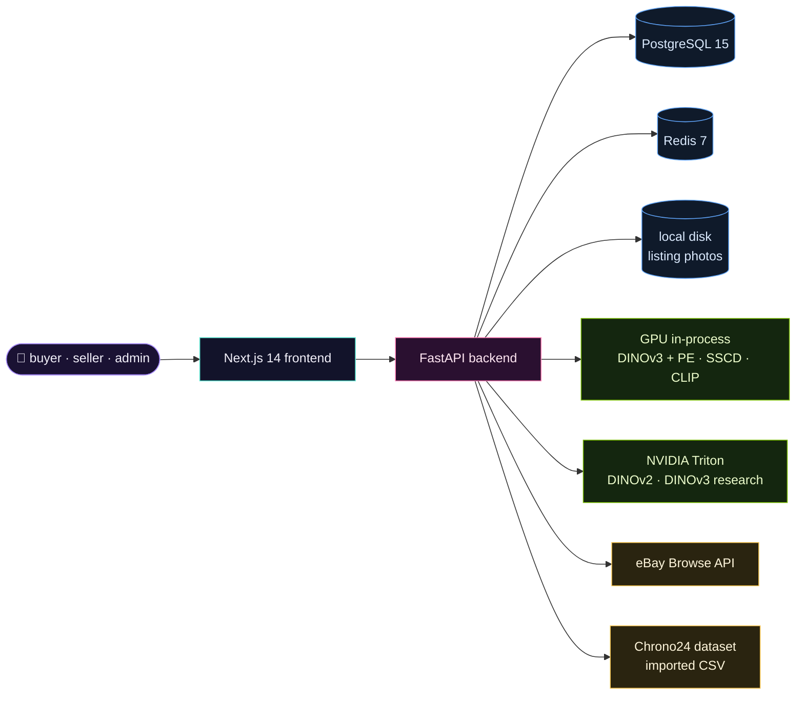

| Layer | Stack |
|---|---|
| 🎨 Frontend | Next.js 14 App Router · TypeScript · Tailwind CSS · TanStack Query · Framer Motion · Recharts |
| ⚙️ Backend | FastAPI (async) · SQLAlchemy 2 + asyncpg · Redis token rotation · Prometheus metrics |
| 🧠 Models | DINOv3 + Perception Encoder (live) · SSCD · CLIP · DINOv2 and DINOv3 on Triton for the Research tab |
| 🗄️ Data | PostgreSQL 15 and Redis 7 in Docker · listing photos on local disk (`backend/local_uploads`) |
| 🖥️ Hardware | one NVIDIA GeForce RTX 5080 (16 GB) for training and serving |

```text
backend/      FastAPI app: auth, listings, screening, research, market
frontend/     Next.js UI
infra/        Docker Compose and Triton model configs
ml_rtx5080/   training, Phases 55–78, benchmarks v1–v7 (RTX 5080)
ml/           earlier DINOv2-Giant reference pipeline
scripts/      Python utilities (seed, export, import, rescreen)
tests/        backend unit tests
```

<p align="center"></p>

## 🚀 Quick start

```bash
python3 -m venv .venv && . .venv/bin/activate
pip install -r requirements.txt
docker compose -f infra/docker-compose.yml up -d postgres redis
cd backend && alembic upgrade head && cd ..
python3 scripts/seed_database.py
```

Settings are read from a `.env` file in the repo root. The defaults and every setting are in `backend/config.py`.

```bash
# API (research mode enables the Research tab)
cd backend && HYPEVAULT_DEPLOYMENT_MODE=research uvicorn main:app --host 127.0.0.1 --port 8000

# Frontend, in a new terminal
cd frontend && npm install && npm run dev
```

| Service | URL |
|---|---|
| 🌐 Frontend | `http://localhost:3000` |
| ⚙️ API | `http://localhost:8000` |
| 🧠 Triton gRPC (Research tab) | `localhost:18001` |

The live hybrid needs a CUDA GPU and the model files under `ml_rtx5080/experiments/`. These are gitignored, except the small heads and rules.

<p align="center"></p>

## 🔌 API

<details open>
<summary><b>Screening and listings</b></summary>

| Route | What it does |
|---|---|
| `POST /verify/authenticate` | Screens a listing photo with the live model (`LIVE_SCREENING_MODEL=phase76_fusion`): listed, held or not listed, with a reason |
| `POST /listings/{id}/proof` | Seller sends the proof photo for a held listing |
| `POST /listings/{id}/review` | Admin approves or rejects a held listing |
| `GET /listings/` · `GET /listings/all` · `GET /listings/recent` | Seller's, admin's and public listings |
| `GET /listings/{id}` · `PATCH /listings/{id}` | One listing |

</details>

<details>
<summary><b>Research, market, auth and operations</b></summary>

| Route | What it does |
|---|---|
| `POST /research/verify` | One of `dinov2_legacy`, `dinov3_experimental`, `phase76_fusion` (needs `HYPEVAULT_DEPLOYMENT_MODE=research` or `shadow`) |
| `POST /research/explain` | Masked-patch map for a research result |
| `GET /research/models` | Readiness of the three research models |
| `GET /market/search` · `POST /market/identify` · `GET /market/history` | Prices and watch identification |
| `POST /auth/register` · `/login` · `/google` · `/refresh` · `/logout` · `GET /auth/me` | Email and Google sign-in, JWT with rotation |
| `GET /health` · `GET /health/ready` · `GET /metrics` | Health and Prometheus metrics |

</details>

<p align="center"></p>

## 🔐 Security

- Secrets live in `.env` only; `.env*`, keys, certificates and service-account JSON are gitignored.
- Only free and open-source tools and data sources are used. Chrono24 is not scraped; its prices come from an imported dataset.
- The Phase 76 head, the DINOv3 checkpoint and the SSCD model are checked by SHA-256 when loaded. A mismatch fails closed with no verdict.

## 📄 License

MIT. See [`LICENSE`](LICENSE).

<p align="center"></p>
