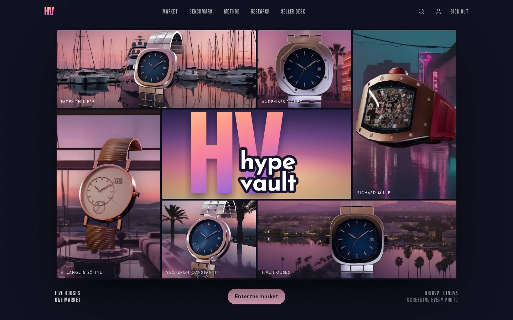
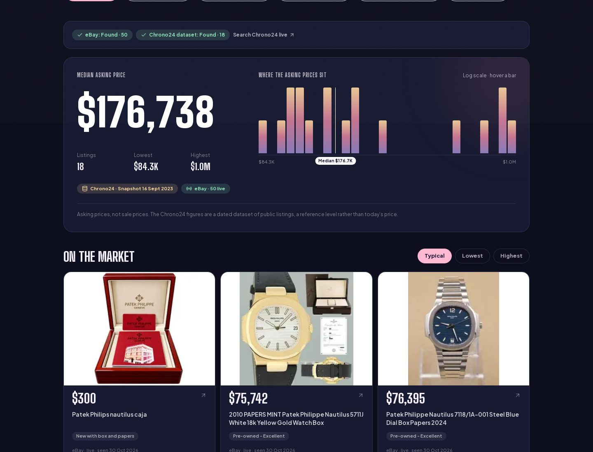
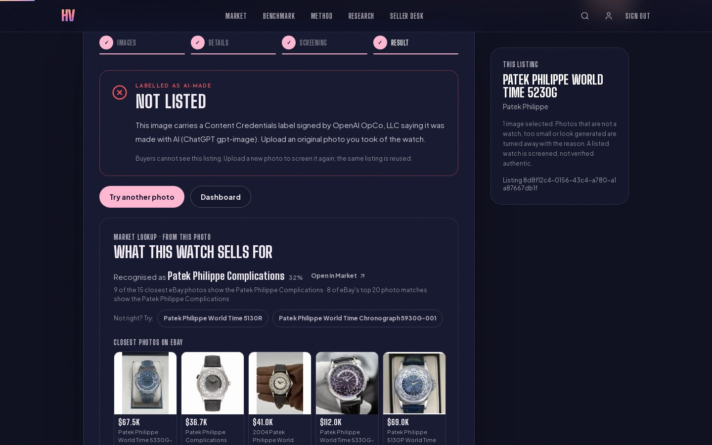
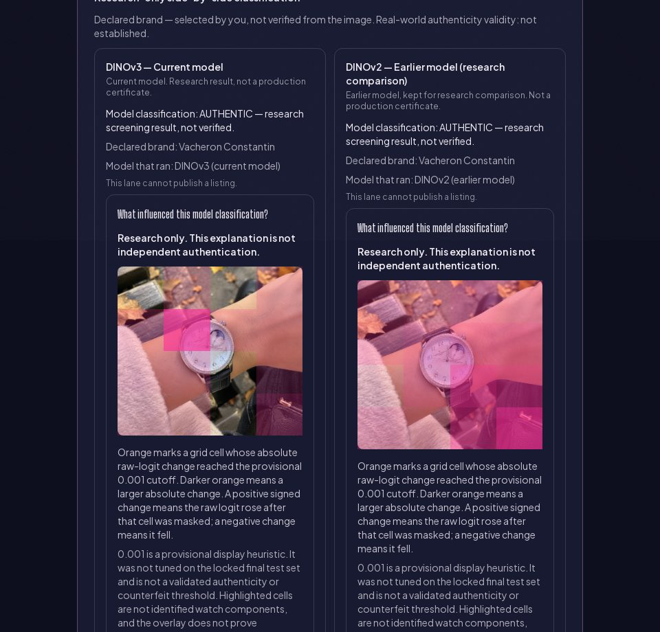
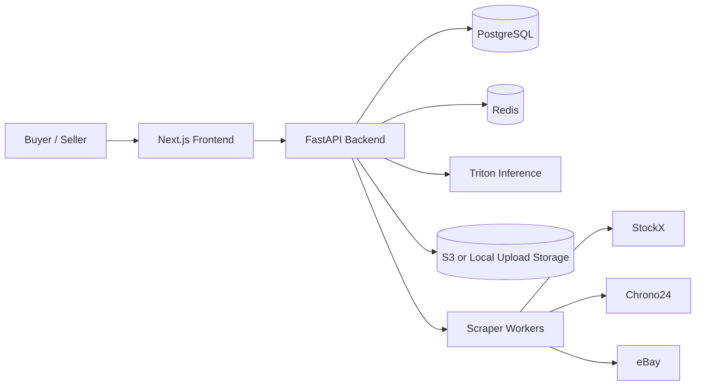
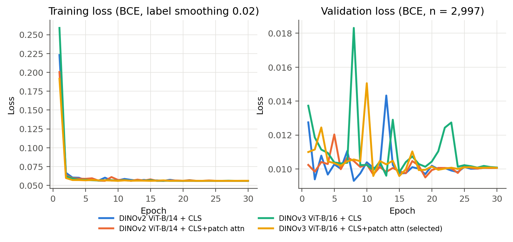
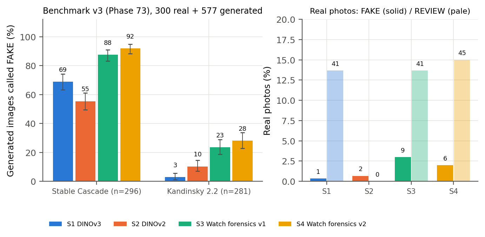

# HypeVault

<p align="center">
  <strong>Five-brand authenticity research prototype</strong><br/>
  Not a universal luxury-watch authenticator, and not ready for production promotion.
</p>

<p align="center">
  <a href="LICENSE"></a>
  
  
  
  
</p>

<p align="center">
  
  
  
  
  
</p>

---

## Quick Navigation

- [Overview](#overview)
- [Screenshots](#screenshots)
- [Core Capabilities](#core-capabilities)
- [Architecture Snapshot](#architecture-snapshot)
- [Repository Structure](#repository-structure)
- [Quick Start](#quick-start)
- [Command Center by Role](#command-center-by-role)
- [API Surface (Key Routes)](#api-surface-key-routes)
- [Demo Script (Presentation Flow)](#demo-script-presentation-flow)
- [Inference Modes](#inference-modes)
- [Model training results](#model-training-results)
- [Security and Secret Handling](#security-and-secret-handling)
- [Production Notes](#production-notes)
- [License](#license)

---

## Current status

`NOT_READY_FOR_PROMOTION`

## Scope

Five-brand authenticity research prototype.

Supported brands:

1. A. Lange & Söhne
2. Audemars Piguet
3. Patek Philippe
4. Richard Mille
5. Vacheron Constantin

General luxury-watch authenticity is unsupported. Open-set rejection is not validated. `production_ood_threshold` is null.

## Validation summary

- Final test: 3,006 in-distribution samples, five brands, calibrated ROC-AUC 1.0, PR-AUC 1.0, F1 1.0, false-authentic 0, false-fake 0. This is not universal authenticity evidence.
- Calibration: 2,998 samples, frozen temperature `0.24038200410185356`.
- Robustness: clean false-authentic 0 and false-fake 0. Quality policy caught 8 of 9 known stress false-fake events. Resize/recompression remains uncovered.
- OOD: Phase 35 is `OOD_FAIL` (337/408 authentic escape; unseen luxury about 88.1%). Phase 36 is `WATCH_OOD_UNRESOLVED` (25 holdout images).
- Serving: live listing checks stay on DINOv2 (`dinov2_vitb14_live`, ViT-B/14 at 504). The frozen research candidate is DINOv3 (`dinov3_authenticity_candidate`). Both are served together on NVIDIA Triton 26.01 GPU with exact FP32 (`use_tf32=0`). The old ViT-G/14 `dinov2_classifier` is not routed. `AUTHENTICITY_MODEL_PRODUCTION_APPROVED` remains false.

## Known blockers

- OOD fail
- Runtime parity between the live DINOv2 path and the frozen DINOv3 candidate
- Serving infrastructure
- Policy approval

## Overview

HypeVault is a marketplace codebase aimed at luxury-watch listings.
The authenticity model is a research prototype for the five brands above.
A declared brand outside that list returns `UNSUPPORTED_SCOPE` and no authentic or fake verdict.

Core principles:
- No authenticity verdict outside the five-brand scope
- Comparable market context is separate from authenticity
- Customer-facing production promotion is forbidden

---

## Screenshots

<table>
  <tr>
    <td width="50%"></td>
    <td width="50%"></td>
  </tr>
  <tr>
    <td><b>Home.</b> The five houses HypeVault covers.</td>
    <td><b>Market.</b> A search shows the median asking price and its spread from the dated Chrono24 dataset and live eBay listings, each figure with its source and date.</td>
  </tr>
  <tr>
    <td></td>
    <td></td>
  </tr>
  <tr>
    <td><b>Seller upload.</b> A ChatGPT image is turned away because its signed Content Credentials label says AI made it. The watch is still identified from the photo, with matching eBay listings and prices.</td>
    <td><b>Research.</b> DINOv3 and DINOv2 side by side, with the patches that moved each score. Both call this ChatGPT image authentic; the Phase 76 head below catches it.</td>
  </tr>
</table>

---

## Core Capabilities

- AI-backed listing verification with Triton or local Torch fallback
- Rejection of photos whose signed Content Credentials (C2PA) label says an AI made them (ChatGPT, Gemini)
- Watch identification from a photo or a name (DINOv3 gallery, dial text, eBay image search), then eBay and Chrono24 prices
- Role-based buyer/seller experiences with JWT session flows
- Google sign-in support (buyer path) plus email/password auth
- Multi-source market comparison (StockX, Chrono24, eBay)
- Cache freshness metadata for comparison responses
- Health, readiness, and metrics endpoints for runtime visibility

---

## Architecture Snapshot



### Frontend
- Next.js 14 App Router
- TypeScript + Tailwind CSS
- TanStack Query + Axios
- Framer Motion + Recharts

### Backend
- FastAPI (async)
- SQLAlchemy 2 + asyncpg
- Redis (auth token rotation + scraper cache)
- Playwright scrapers
- Triton gRPC inference client
- Prometheus metrics endpoint

### Infrastructure
- Docker Compose for local Postgres/Redis/Triton
- Docker and Triton configs under `infra/`
- Listing photos stored on local disk (`backend/local_uploads`)

---

## Repository Structure

```text
backend/      FastAPI app, auth, listings, inference, scraper
frontend/     Next.js UI and client integrations
infra/        Docker and deployment helper artifacts
ml/           Training and model utility scripts (DINOv2-Giant reference pipeline)
ml_rtx5080/   ViT-B / 504px training pipeline and checkpoints (RTX 5080)
scripts/      Python utilities; optional local *.sh helpers are gitignored
```

---

## Quick Start

### 1) Fast path

From repo root (with Docker running). Shell helpers under `scripts/` are **not** tracked in git; use the manual path below or keep your own local `dev_setup.sh`.

### 2) Manual path (recommended clone)

```bash
python3 -m venv .venv
. .venv/bin/activate
pip install -r requirements.txt
docker compose -f infra/docker-compose.yml up -d postgres redis
cd backend && alembic upgrade head && cd ..
python3 scripts/seed_database.py
```

Start API:

```bash
cd backend
uvicorn main:app --reload --host 0.0.0.0 --port 8000
```

Start frontend:

```bash
cd frontend
npm install
npm run dev
```

Application URLs:
- Frontend: `http://localhost:3000`
- API: `http://localhost:8000`
- Triton gRPC (host): `localhost:18001`

Environment template:
- Copy `.env.example` to `.env` and fill runtime credentials before non-local deployment.

---

## Command Center by Role

<table>
  <tr>
    <td width="33%" valign="top">
      <h3>Developer</h3>
      <p>Run application stack for feature work.</p>
      <pre><code>cd ~/Desktop/HypeVault
python3 -m venv .venv && . .venv/bin/activate
pip install -r requirements.txt
docker compose -f infra/docker-compose.yml up -d postgres redis
cd backend && alembic upgrade head && cd .. && python scripts/seed_database.py
cd backend && uvicorn main:app --reload --host 0.0.0.0 --port 8000
# new terminal
cd frontend && npm install && npm run dev</code></pre>
    </td>
    <td width="33%" valign="top">
      <h3>Infrastructure</h3>
      <p>Bring dependencies and readiness online.</p>
      <pre><code>cd ~/Desktop/HypeVault
docker compose -f infra/docker-compose.yml up -d postgres redis triton
curl -sS http://localhost:8000/health
curl -sS -i http://localhost:8000/health/ready</code></pre>
    </td>
    <td width="33%" valign="top">
      <h3>ML / Inference</h3>
      <p>Export and run model path.</p>
      <pre><code>cd ~/Desktop/HypeVault
. .venv/bin/activate
python scripts/export_tensorrt.py
# fallback mode
export INFERENCE_BACKEND=torch
export LOCAL_MODEL_PATH=models/hypevault_classifier.pt</code></pre>
    </td>
  </tr>
</table>

---

## API Surface (Key Routes)

<details open>
  <summary><strong>Authentication</strong></summary>

- `POST /auth/register`
- `POST /auth/login`
- `POST /auth/google`
- `POST /auth/refresh`
- `POST /auth/logout`
- `GET /auth/me`

</details>

<details open>
  <summary><strong>Verification and Listings</strong></summary>

- `POST /verify/authenticate` — legacy DINOv2 listing check. `model = LEGACY_DINOV2`, `research_candidate = false`, `production_validation = NOT_ESTABLISHED`. It is not the DINOv3 research prototype. The brand field is user-declared. Unsupported brands return HTTP 422 `UNSUPPORTED_SCOPE` with `decision = null`.
- `POST /research/verify` — frozen DINOv3 five-brand research prototype. Requires `HYPEVAULT_DEPLOYMENT_MODE=research` or `shadow`. Production, missing, and unknown modes return `POLICY_ERROR` with `decision = null`. `brand_verification = NOT_PERFORMED`, `research_only = true`, `production_ready = false`.
- `POST /listings/`
- `GET /listings/`
- `GET /listings/recent`
- `GET /listings/compare?q=...`
- `GET /listings/{id}/comparison`

</details>

<details>
  <summary><strong>Operations</strong></summary>

- `GET /health`
- `GET /health/ready`
- `GET /metrics`

</details>

---

## Demo Script (Presentation Flow)

Use this minimal runbook for a polished live demo:

1. **Open landing page** and position the narrative: AI-gated trust layer for luxury commerce.
2. **Authenticate as seller**, create/upload listing, run verification.
3. **Show verdict + confidence** and explain gating logic.
4. **Open comparison panel** and highlight cross-market pricing context.
5. **Switch to buyer perspective** and show curated discovery flow.
6. **Close with operations proof** using `GET /health/ready` and `GET /metrics`.

Presentation-ready command block:

```bash
curl -sS http://localhost:8000/health
curl -sS -i http://localhost:8000/health/ready
curl -sS http://localhost:8000/metrics | sed -n '1,20p'
```

---

## Inference Modes

Two allowlisted Triton models, selected by a logical id. Triton model names are server-side and are rejected as client selectors.

| Logical id | Triton model | Artifact | Input | Role |
| --- | --- | --- | --- | --- |
| `dinov2_legacy` | `dinov2_vitb14_live` v1 | live ViT-B/14 checkpoint `fe1daa0b…fa66` | `[1,3,504,504]` FP32 | live listing check and research selector |
| `dinov3_experimental` | `dinov3_authenticity_candidate` v1 | frozen `epoch_018.pt` `5a38c93f…d28f`, temperature `0.24038200410185356` | `[1,3,512,512]` FP32 | research/shadow only |

Validated GPU serving is `KIND_GPU` with `use_tf32=0`. The SHA-256 of the DINOv3 checkpoint is verified at API startup and cached; a mismatch fails closed (`decision = null`) and is not hashed again on every request. Production mode cannot select DINOv3. Neither model auto-publishes a listing.

The unrouted `dinov2_classifier` ViT-G/14 518 artifact is not a substitute for either selector model.

### Local Torch fallback
Use when Triton is unavailable for the live DINOv2 listing path:

```bash
pip install -r requirements_inference.txt
```

Then configure in `.env`:
- `INFERENCE_BACKEND=torch`
- `LOCAL_MODEL_PATH=models/hypevault_classifier.pt`
- `DINOV2_MODEL_NAME=dinov2_vitg14_reg`

Switch back to `INFERENCE_BACKEND=triton` for production parity.

---

## Model training results

Binary classifier: **real photograph (label 0)** vs **AI-generated image (label 1)** for the five supported brands. All runs are on an **NVIDIA GeForce RTX 5080** (16 GB) with `ml_rtx5080/`. The classifier does not judge whether a watch is genuine.

### Training and locked test

Four configurations (DINOv2 ViT-B/14 and DINOv3 ViT-B/16, each CLS-only or CLS + patch attention) were trained on 20,999 images for 30 epochs in BF16. The selection rule was written before the test set was opened, and it picked **DINOv3 ViT-B/16 + CLS + patch attention, epoch 18** (temperature T = 0.2404).

<p align="center">
  
</p>

<p align="center">
  
</p>

| Measure | Result |
|---|---|
| Peak training GPU memory | 8.26–9.09 GiB |
| Locked final test (3,006 images, opened once) | 0 errors; false-authentic 0 / 1,500 (95% upper bound 0.26%) |
| Calibration (2,998 images) | ECE 0.0098 → 0 after temperature scaling |
| Leave-one-brand-out, surface-normalized images | 9 / 13,500 generated accepted (0.067%) |
| Triton serving, batch 1, p95 latency | 16.55 ms (DINOv3), 20.03 ms (DINOv2) |
| Triton throughput, batch 1 | 61.8 img/s (DINOv3), 51.6 img/s (DINOv2) |
| Repeatability | 0 logit changes in 1,800 requests |

The locked test uses images from the same sources as training, so it shows in-distribution separation only.

### Fresh pre-registered benchmarks (new eBay photos, new generators)

Each benchmark had a protocol written before its images existed, rules frozen on earlier data, and a single scoring run.

| Benchmark | Question | Result |
|---|---|---|
| v1: 300 eBay, 284 Kandinsky 2.2, 150 SDXL | DINOv2 or DINOv3? | Underpowered (16 discordant, p = 0.21). **DINOv2 stays live.** Both models accept most Kandinsky images |
| v2: 300 eBay, 287 Kandinsky 2.2, 293 aMUSEd | Watch forensics v1 vs DINOv3 | 63.4% vs 24.1% caught, but 3.7% of real photos rejected. **Not met** (limit +3 points) |
| v3: 300 eBay, 296 Stable Cascade, 281 Kandinsky 2.2 | Watch forensics v2 vs DINOv3 | Stable Cascade 91.9% vs 68.9% caught (p = 2.3 × 10⁻¹⁰); real photos rejected 2.0% vs 0.3%. **Met** |
| v4: 270 eBay, 283 Kandinsky 2.2 (143 from new scene prompts), 297 Stable Cascade | DINOv3 Kandinsky v4 head: ≥ 80% of Kandinsky, ≤ 3% of real photos | Kandinsky 283/283 (100%) vs 8.1% for DINOv3 alone; Stable Cascade 297/297; real photos rejected 2/270 (0.7%). **Met.** Kandinsky and Stable Cascade were in its training data |
| v5: 144 eBay, 75 ChatGPT, 75 Gemini watch images | Phase 75 frontier head: ≥ 80% of each app, ≤ 3% of real photos | ChatGPT 12%, Gemini 36% caught; real photos rejected 2.1%. **Not met** |
| v6: 102 eBay, 30 ChatGPT, 17 Gemini (+13 from a second Gemini account, reported apart) | Phase 76 DINOv3 + Perception Encoder head: ≥ 80% of each app, ≤ 3% of real photos | ChatGPT 30/30, Gemini 17/17 (+13/13) vs 13% / 0% for DINOv2; real photos rejected 2/102. **Met.** ChatGPT and Gemini were in its training data |

<p align="center">
  
</p>

Watch forensics v2 combines the fine-tuned DINOv3, a decoder-trace probe and a dial-text check. Its limits:

- Kandinsky 2.2 is still mostly missed (28.1% caught).
- 15% of real photos go to human review.

It is a research result. The live app screens with DINOv2, and only the dial-text check is live, as a hint to the seller. Details: `ml_rtx5080/benchmark_v3_fresh/report.md`.

Phase 74 adds one logistic-regression head on the fine-tuned DINOv3's own CLS and attention-pooled features, trained on several generators (Kandinsky 2.2, SDXL, aMUSEd, Stable Cascade). On benchmark_v4 it caught every Kandinsky and Stable Cascade image, but both generators were in its training data. In a later development-data check, each generator was left out of training in turn. Never-seen Kandinsky was still caught 83.3% of the time (93.4% with pretrained DINOv3 features added), and the other three 98.7–99.7%. Real-photo false alarms were 0.9–1.6%. A pre-registered test on a newer unseen generator is next. Details: `ml_rtx5080/benchmark_v4_fresh/report.md`.

Phase 76 fuses two frozen backbones, DINOv3 (pretrained and fine-tuned) and Meta's Perception Encoder L/14, with one logistic-regression head. It was trained on the spent benchmark_v5 ChatGPT and Gemini images among others. On the fresh benchmark_v6 it caught every ChatGPT and Gemini watch image, and beat DINOv2 and Phase 75 in every group (McNemar p < 0.01). Five of the 60 images were caught by less than 1.0 logit. It is a seen-app result: unseen generators are not tested. Deviations are logged in `ml_rtx5080/benchmark_v6_fresh/protocol.json`. The Content Credentials label was present on all 60 original files, and the live upload check rejects them on that label alone.

> Checkpoint weights (`.pt`, `.onnx`, etc.) stay **gitignored**; only these PNG artifacts are tracked for documentation.

---

## Security and Secret Handling

- Never commit secrets.
- Keep runtime values in environment variables only.
- Use a local env template (keep secrets out of git).
- `.gitignore` is configured to exclude:
  - `.env*` and `.env.example`
  - key/cert artifacts
  - service-account JSON files
  - heavyweight training and dataset folders

Before each push:
- verify no secret-bearing files are staged
- keep machine-specific `.env` and credential material local-only

---

## Production Notes

Customer-facing promotion of the authenticity model is forbidden. The notes below are operational only.

- Ensure Redis is healthy for token rotation and cache paths
- Treat external scraping as best-effort and failure-tolerant
- Monitor readiness and metrics before exposing user traffic
- Keep Triton model readiness green before enabling verification-dependent flows

---

## License

MIT License. See `LICENSE`.
